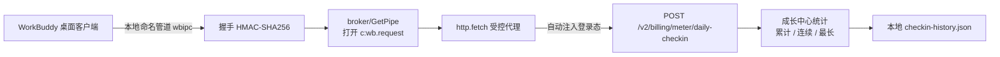

# WorkBuddy 每日自动签到

一个**零依赖**的 Node.js 小工具，利用 WorkBuddy 桌面客户端在本机托管的登录态，
自动完成「Buddy 加油站」每日签到，领取每日积分（连续签到还有额外奖励）。

> 特点：**零配置**（复用客户端本地登录态，无需手动填 token）、**幂等**（重复运行安全）、
> **可移植**（自动定位数据目录，支持环境变量覆盖）、**可被定时任务调用**（明确退出码 + `--json` 输出）。

---

## 一、工作原理（高层）

WorkBuddy 桌面客户端在后台托管了一个本地进程间通信守护进程（命名管道 `wbipc`）。
客户端会在数据目录写入一个 `endpoint.json`，包含管道名与一次性票据（ticket）。

本工具：

1. 读取本机 `endpoint.json`（自动从用户主目录定位，无需配置）；
2. 通过 `wbipc` 完成一次**带双向认证握手的会话**（基于 HMAC-SHA256）；
3. 用受控 HTTP 代理通道（`wb.request/http.fetch`）调用后端，
   该通道会由客户端**自动注入当前登录态**；
4. 调用签到接口 `POST /v2/billing/meter/daily-checkin` 完成签到。

签到成功后，工具会在本机写入一个本地历史文件（默认 `<wbipc 目录>/checkin-history.json`），
据此计算「累计 / 当前连续 / 最长连续」天数，并在日志里以「成长中心」形式展示。
这部分**完全本地、不依赖接口字段**，即使断网或后端接口改版也不影响统计。

整个过程不接触、不导出你的账号密码或长效令牌，仅使用客户端自己生成的本地会话。

### 工作流示意图



---

## 二、环境要求

- **Node.js ≥ 16**（仅使用内置模块，无需 `npm install` 任何依赖）
- **WorkBuddy 桌面客户端处于运行状态**（管道由客户端托管；客户端通常随系统自启并驻留系统托盘）
- 操作系统：Windows / macOS 桌面客户端（已在 Windows 验证；签到为桌面端功能）

---

## 三、安装（任何人都可以）

### 方式 A：直接下载脚本（最简）

把本仓库的 `checkin.js` 放到任意目录即可，**无需安装依赖**。

### 方式 B：克隆仓库

```bash
git clone <本仓库地址> workbuddy-checkin
cd workbuddy-checkin
# 零依赖，无需 npm install
```

> 提示：本工具只用 Node 内置模块，`npm install` 是可选项（仅为满足约定）。
> 需要自定义路径或部署到其它机器时，参考根目录 [`.env.example`](./.env.example) 设置环境变量即可——**默认零配置即可运行**。

---

## 四、使用

### 0. 用启动器运行（推荐，跨 shell 免踩坑）

仓库附带两个启动器，会**自动定位 node**（优先 WorkBuddy 托管 node，否则 PATH 上的 node），
你无需关心 node 路径与反斜杠问题：

```bash
# Windows CMD / 双击：
C:\...\workbuddy-checkin\run-checkin.bat

# Git Bash / WSL / 标准 bash（注意用 POSIX 路径）：
bash /c/Users/你的用户名/.workbuddy/wbipc/run-checkin.sh
```

### 1. 直接运行

```bash
node checkin.js
```

> ⚠️ **Shell 路径陷阱**：在 Git Bash / WSL 等 POSIX shell 里，`C:\Users\...` 这种
> 反斜杠路径会被当作转义符吞掉（报 `command not found`/退出码 127）。务必改成
> POSIX 写法 `/c/Users/...`，或直接用上面的启动器。

首次在本机运行后，日志会写入 WorkBuddy 数据目录下的 `checkin.log`。

### 2. 查看今日签到状态（可选）

```bash
node checkin.js --status      # 或 -s
```

### 3. 机器可读输出（便于被定时任务 / CI 解析）

```bash
node checkin.js --json        # 或 -j
# 示例输出：{"ok":true,"code":0,"message":"今日已签到","status":200,"body":{...},"streak":{"total":12,"current":5,"longest":20}}
```

> 另可用 `--no-stats`（或 `-S`）关闭本地连续天数统计（不读写历史文件）；
> 用环境变量 `WBIP_NO_STATS=1` 可达到同样效果。

### 4. 环境变量

| 变量 | 说明 | 默认值 |
| --- | --- | --- |
| `WBIP_ENDPOINT_FILE` | 显式指定 `endpoint.json` 文件路径（缺失即报错，不回退） | 自动探测 |
| `WORKBUDDY_HOME` | 指定 WorkBuddy 主目录（其下应有 `wbipc/endpoint.json`） | 自动探测 |
| `WBIP_ENDPOINT` + `WBIP_TICKET` | 直连模式：同时提供管道与票据，跳过读取 `endpoint.json`（高级部署用） | 无 |
| `WBIP_LOG` | 指定日志文件路径 | `<wbipc 目录>/checkin.log` |
| `WBIP_CHECKIN_HISTORY` | 连续签到统计历史文件路径（成长中心功能用） | `<wbipc 目录>/checkin-history.json` |
| `WBIP_NO_STATS` | 设为 `1` 关闭本地连续天数统计（不读写历史文件） | `0`（默认开启） |

### 5. 退出码（供调用方判断）

| 退出码 | 含义 |
| --- | --- |
| `0` | 成功 / 今日已签到（幂等） |
| `1` | 业务异常（接口返回非预期） |
| `2` | 缺少登录态（未找到 `endpoint.json` 或字段缺失） |
| `3` | 连接 / 握手失败（多半是 WorkBuddy 客户端未运行） |
| `4` | 调用签到接口失败（网络 / 协议异常） |

---

## 五、接入 WorkBuddy 定时任务

你可以用 **WorkBuddy 自带的定时任务 / 自动化**来每天执行本工具。建议直接调用启动器
（它会自动定位 node，避免路径格式问题）：

```bash
# Git Bash 环境（自动化默认）：
bash /c/Users/你的用户名/.workbuddy/wbipc/run-checkin.sh

# 或 Windows CMD 环境：
C:\Users\你的用户名\.workbuddy\wbipc\run-checkin.bat
```

也可以直接运行脚本本体（注意用 POSIX 路径）：

```bash
node /绝对路径/workbuddy-checkin/checkin.js
```

或在项目目录内：

```bash
npm start
```

建议配置：

- **触发频率**：每天 1 次（例如每天 09:30）；
- **前置条件**：确保 WorkBuddy 客户端已启动（否则退出码 3，可配置失败重试）；
- **结果判断**：读取退出码（0=成功）或解析 `--json` 输出；
- **通知**：可结合 WorkBuddy 的「完成后通知」能力，在 `ok=true` 时推送「今日签到成功 ✅」。

> 因为签到接口对「当天已签」返回 `code:10001`，工具已将其视为成功（exit 0），
> 所以即使定时任务在当天被多次触发，也始终安全、不会产生副作用。

---

## 六、幂等与防重复

- 后端本身对当日重复签到返回 `code:10001`，工具识别后当作「今日已签到」成功处理；
- 因此**每天跑一次即可**，多次运行不会重复发奖，也不会报错。

---

## 七、常见问题

**Q：运行后报 `连接管道失败 / 握手失败`？**
A：WorkBuddy 客户端未运行，或登录态已过期。请先打开并登录 WorkBuddy 客户端后重试。

**Q：找不到 `endpoint.json`？**
A：确认已安装并运行过 WorkBuddy 桌面客户端。若数据目录不在默认位置，可用
`WORKBUDDY_HOME` 指定主目录，或用 `WBIP_ENDPOINT_FILE` 直接指定文件路径。

**Q：提示「今天已签到」？**
A：这是正常结果，说明今天的签到已记录（可能是客户端自身或本工具完成的），无需担心。

**Q：能领多少积分？**
A：以 WorkBuddy 客户端「Buddy 加油站」页面显示为准（通常每日约 100 积分，连续签到有额外奖励）。

---

## 八、安全与隐私

- 本工具**不会**收集、上传任何账号密码或长效令牌；
- 所有通信都在本机 `wbipc` 管道与 WorkBuddy 官方后端之间进行；
- 仅使用客户端自身生成的、有时效的本地会话来完成签到；
- 本工具为非官方辅助脚本，使用即表示理解并自担风险。

---

## 九、目录结构

```
workbuddy-checkin/
├── checkin.js        # CLI 入口 + 可复用库（runCheckin / findEndpointFile / computeStreak 导出）
├── src/
│   └── wbipc.js      # wbipc 命名管道客户端库（连接/握手/受控代理，零依赖）
├── run-checkin.sh    # POSIX 启动器（Git Bash/WSL，自动定位 node）
├── run-checkin.bat   # Windows 启动器（CMD/双击，自动定位 node）
├── package.json      # 项目元信息 / 启动脚本
├── README.md         # 本说明
├── LICENSE           # MIT License
├── .env.example      # 环境变量示例（零配置即可运行，按需复制为 .env）
└── .gitignore
# 运行期会在 wbipc 目录生成：checkin.log、checkin-history.json（连续签到统计）
```

### 作为库调用

`checkin.js` 同时是库，可被其他 Node 程序 `require`：

```js
const { runCheckin, EXIT } = require('workbuddy-daily-checkin');
const r = await runCheckin({ status: false });
// r = { ok, code, message, status, body }
// 退出码语义同 CLI：0=成功/已签，1=业务异常，2=缺登录态，3=连接失败，4=调用失败
```

底层 IPC 也可单独使用：

```js
const { connect } = require('workbuddy-daily-checkin/src/wbipc');
const session = await connect(raw.endpoint, raw.ticket);
const res = await session.httpFetch('POST', '/v2/billing/meter/daily-checkin');
session.close();
```

---

## 附：社区开源方案对比

本类工具在 GitHub / 社区已有不少实现，主要分两类思路：

| 项目 | 语言 | 思路 | 与本项目差异 |
| --- | --- | --- | --- |
| [88lin/workbuddy-auto-signin](https://github.com/88lin/workbuddy-auto-signin) | Python | 读本机登录态，签到+成长中心全套 | 最火（~794★），但为 Python 系 |
| [cat-xierluo/legal-skills](https://github.com/cat-xierluo/legal-skills) 中的 `workbuddy-checkin` | **Node.js** | 读明文 JSON 登录态，Bearer 直调官方接口 | **技术栈最贴近本项目** |
| [L0NE-6/WorkBuddy-Daily](https://github.com/L0NE-6/WorkBuddy-Daily) | Python | 青龙/GitHub Actions，33 项任务 | 部署形态不同 |
| [liubinne/workbuddy-free-credits](https://github.com/liubinne/workbuddy-free-credits) | Python | Skill 化安装，定时领分 | Skill 形态 |
| [StormZ0/workbuddy-web-checkin](https://github.com/StormZ0/workbuddy-web-checkin) | Node/Playwright | 网页版 cookie 方案 | 无桌面端依赖，但需浏览器 |
| [changexbc/workbuddy-switch](https://github.com/changexbc/workbuddy-switch) | npm/Tauri | 多账号切换+自动签到 | 多账号场景 |

**本项目的差异化定位（质量卖点）：**

- **唯一走「wbipc 命名管道握手 + 受控代理」的方案**：不提取、不重放任何 token，
  直接复用客户端活体 IPC 会话（host 自动注入登录态）。其余多数方案是
  「读 token 文件 → 拿 Bearer 直调官方接口」，凭证在脚本侧落过一次手。
- **权限最小化**：仅读取 `endpoint.json`，不写、不改、不删任何客户端文件。
- **零依赖 + 模块化**：仅用 Node 内置模块；`src/wbipc.js` 是可独立测试的库，
  `checkin.js` 同时是 CLI 与库，便于二次开发或嵌入。

> 风险提示：签到接口来自对桌面端的逆向分析，官方改版可能导致失效；本脚本以 MIT
> 开源，便于社区共同维护。

---

## 十、许可证

本项目以 **MIT License** 开源，详见仓库根目录 [LICENSE](./LICENSE) 文件。
